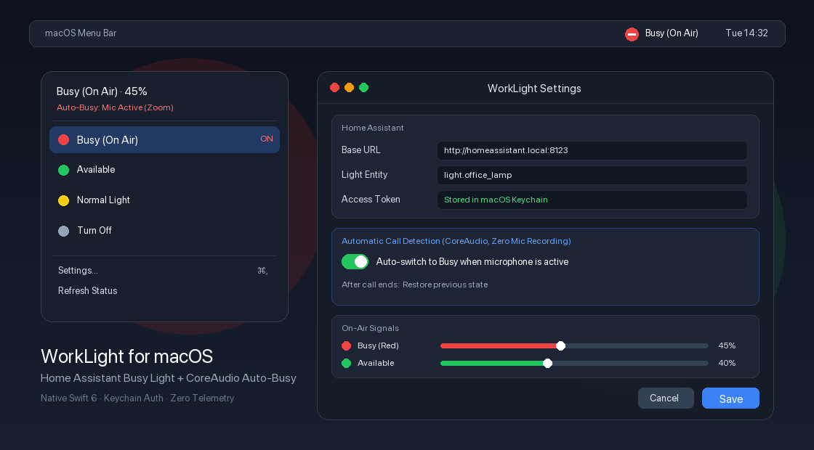

# WorkLight

[](https://github.com/alexandryasukaitisss-cmd/worklight-macos/actions/workflows/ci.yml)
[](https://github.com/alexandryasukaitisss-cmd/worklight-macos/releases)
[](https://github.com/alexandryasukaitisss-cmd/worklight-macos)
[](LICENSE)

[Русский](README.ru.md) · [Releases](https://github.com/alexandryasukaitisss-cmd/worklight-macos/releases) · [MIT](LICENSE)

**A native macOS menu bar On-Air / Busy Light controller for any Home Assistant RGB lamp — with optional local automatic Busy mode when your microphone is active.**



Click the menu bar icon to flip your room or desk lamp between **Busy (Red)** and **Available (Green)**, right-click for **Normal Light** or **Turn Off**, or enable **Automatic Call Detection** so Zoom, Google Meet, Microsoft Teams, Slack Huddles, and FaceTime turn your lamp red automatically and restore it when the call ends.

## Features

- **1-click Busy / Available toggle** — left-click toggles Red/Green; right-click opens scenes (**Busy**, **Available**, **Normal Light**, **Turn Off**) and **Settings…**.
- **Automatic Call Detection (optional, local-only)** — polls macOS CoreAudio hardware running state (`kAudioDevicePropertyDeviceIsRunningSomewhere`) to flip the lamp Red whenever any microphone input is live, then restores your previous light state afterward. **Records zero audio and requires zero microphone permission.** If you manually change the light mid-call, WorkLight respects your override.
- **Works with any Home Assistant `light.*` entity** — Philips Hue, LIFX, Zigbee2MQTT, WLED, Matter, and optional Xiaomi/Yeelight Miot effect mode (`Color` / `Day`).
- **Confirmed state writes** — verifies Home Assistant responses before marking a switch complete; blocks HTTP redirects and stores your Long-Lived Access Token in **macOS Keychain** (or optional `~/.config/worklight/token` / `WORKLIGHT_HA_TOKEN_FILE`).
- **Lightweight native Swift** — built with Swift 6, AppKit, and SwiftUI (`LSUIElement`), zero Electron, zero telemetry.

## Install

### Homebrew (recommended)

```sh
brew install --cask alexandryasukaitisss-cmd/tap/worklight
```

### Direct download

Download `WorkLight-0.1.0-macos-arm64.zip` from [GitHub Releases](https://github.com/alexandryasukaitisss-cmd/worklight-macos/releases), unzip, and move `WorkLight.app` into `/Applications`.

> [!NOTE]
> **First launch on macOS (not Apple-notarized):** Prebuilt releases are ad-hoc signed, so macOS Gatekeeper will show *"Apple could not verify 'WorkLight' is free of malware"* on first launch. To open it once:
> - **Without Terminal:** click **Done** (not *Move to Trash*), open **System Settings → Privacy & Security**, scroll down to **Security**, and click **Open Anyway**.
> - **Or via Terminal:** `xattr -dr com.apple.quarantine /Applications/WorkLight.app`

### Build from source (macOS 14+, Swift 6)

```sh
git clone https://github.com/alexandryasukaitisss-cmd/worklight-macos.git
cd worklight-macos
chmod +x script/build_and_run.sh
./script/build_and_run.sh --run
```

## Setup (60 seconds)

1. In Home Assistant, open your **Profile → Security → Long-Lived Access Tokens** and create a token.
2. Click the WorkLight icon in your macOS menu bar → **Settings…**.
3. Enter your **Home Assistant Base URL** (e.g., `http://homeassistant.local:8123`), your **Light Entity ID** (e.g., `light.office_lamp`), and paste your **Access Token** (stored in macOS Keychain).
4. *(Optional)* Enable **Switch to Busy automatically when microphone is active** and pick what the lamp should return to after a call ends.

## Tests

```sh
swift test
```

## License

MIT. See [LICENSE](LICENSE).
