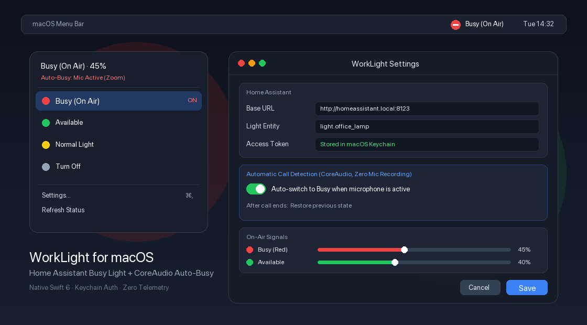

# WorkLight

[](https://github.com/alexandryasukaitisss-cmd/worklight-macos/actions/workflows/ci.yml)
[](https://github.com/alexandryasukaitisss-cmd/worklight-macos/releases)
[](https://github.com/alexandryasukaitisss-cmd/worklight-macos)
[](LICENSE)

[English](README.md) · [Релизы](https://github.com/alexandryasukaitisss-cmd/worklight-macos/releases) · [MIT](LICENSE)

**Нативное macOS-приложение в menu bar для управления RGB-лампой «Занят / Свободен» (On-Air / Busy Light) через Home Assistant — с опциональным автоматическим включением красного света на время звонков.**



Левый клик по иконке в строке меню переключает лампу между **Busy (Красный)** и **Available (Зелёный)**, правый клик открывает сцены (**Обычный свет**, **Выключить**) и настройки. При включённом авто-режиме лампа сама загорается красным во время звонков в Zoom, Google Meet, Teams, Slack или FaceTime и возвращается в прежнее состояние после звонка.

## Возможности

- **Переключение в 1 клик** — мгновенный «светофор» прямо из macOS menu bar.
- **Авто-режим по активности микрофона (опционально, локально)** — читает только аппаратный флаг CoreAudio (`kAudioDevicePropertyDeviceIsRunningSomewhere`), **не записывает звук и не запрашивает доступ к микрофону**. Если вы вручную переключили свет во время звонка, приложение не перебивает ваше решение.
- **Любая RGB-лампа в Home Assistant (`light.*`)** — Hue, LIFX, Zigbee2MQTT, WLED, Matter, а также опциональный режим эффектов `Color` / `Day` для Xiaomi / Yeelight Miot.
- **Безопасность и подтверждение состояния** — токен хранится в **macOS Keychain** (или в файле `~/.config/worklight/token`), HTTP-редиректы запрещены, а переключение подтверждается ответом Home Assistant.
- **Лёгкий нативный Swift 6** — AppKit + SwiftUI (`LSUIElement`), без Electron и телеметрии.

## Установка

### Homebrew (рекомендуется)

```sh
brew install --cask alexandryasukaitisss-cmd/tap/worklight
```

### Прямое скачивание

Скачайте `WorkLight-0.1.0-macos-arm64.zip` из [GitHub Releases](https://github.com/alexandryasukaitisss-cmd/worklight-macos/releases), распакуйте и перенесите `WorkLight.app` в `/Applications`.

> [!NOTE]
> **Первый запуск на macOS (без платной нотаризации Apple):** Готовые сборки подписаны ad-hoc, поэтому при первом запуске Gatekeeper покажет предупреждение *«Apple не удалось подтвердить, что файл «WorkLight» не содержит вредоносного ПО»*. Чтобы открыть один раз:
> - **Без Терминала:** нажмите **«Готово»** (не *«Переместить в Корзину»*), откройте **Системные настройки → Конфиденциальность и безопасность**, прокрутите до блока **Безопасность** и нажмите **«Всё равно открыть»**.
> - **Или через Терминал:** `xattr -dr com.apple.quarantine /Applications/WorkLight.app`

### Сборка из исходников (macOS 14+, Swift 6)

```sh
git clone https://github.com/alexandryasukaitisss-cmd/worklight-macos.git
cd worklight-macos
chmod +x script/build_and_run.sh
./script/build_and_run.sh --run
```

## Тесты

```sh
swift test
```

## Лицензия

MIT. См. [LICENSE](LICENSE).
